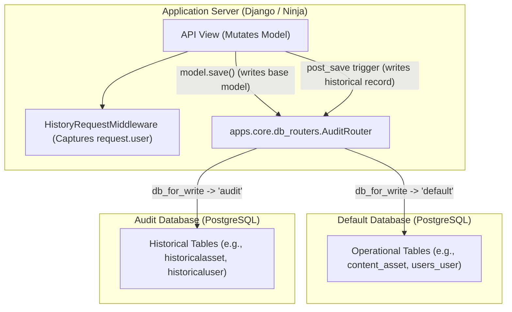
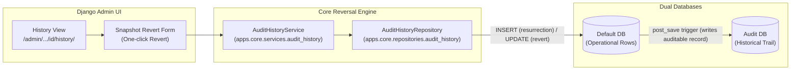

# Audit History — Developer Guide

This document describes the audit history architecture in Itqan CMS, how `django-simple-history` is configured across models, how records are routed to the dedicated `audit` database, and how to maintain tracked models.

---

## Architecture Overview

Audit logging in Itqan CMS uses [`django-simple-history`](https://django-simple-history.readthedocs.io/) with a dual-database setup:
- **`default` database**: Stores all primary operational application data (`users`, `publishers`, `content`, `quran`).
- **`audit` database**: Stores all historical audit trail tables (`simple_history` app).

The separation is enforced at runtime via `apps.core.db_routers.AuditRouter`.



---

## Adding History to a Model

1. **Add the `history` field** to the model definition:

   ```python
   from django.db import models
   from simple_history.models import HistoricalRecords

   class MyModel(BaseModel):
       # ... fields ...
       history = HistoricalRecords(
           app="simple_history",
           use_base_model_db=False,
           history_user_id_field=models.BigIntegerField(null=True),
       )
   ```

   > [!IMPORTANT]
   > **All three parameters are mandatory:**
   >
   > - **`app="simple_history"`**: Sets the generated historical model's `app_label` to `simple_history`. This is required by `apps.core.db_routers.AuditRouter` to correctly route historical tables to the `audit` database.
   > - **`use_base_model_db=False`**: Instructs `django-simple-history` to respect `DATABASE_ROUTERS` instead of writing to the tracked model's database. Omitting it silently routes history tables to `default`.
   > - **`history_user_id_field=models.BigIntegerField(null=True)`**: Stores the authenticated user's ID as a plain scalar column instead of a Django `ForeignKey`. This eliminates cross-database relational constraint errors between the `audit` database and the `default` database.

2. **ForeignKey String Qualification Rule**:
   When defining string-based ForeignKey references on a model with `history` (e.g. self-referential or same-app models), **always use the fully qualified app label** (e.g. `"content.Asset"` instead of `"Asset"`). Because historical models belong to `app_label="simple_history"`, unqualified strings will otherwise resolve against `simple_history.<Model>` and trigger migration errors (`fields.E300`/`fields.E307`).

3. **Generate the migration**:
   Historical model migrations are redirected to `apps/core/audit_migrations/` via `settings.MIGRATION_MODULES`:

   ```bash
   uv run python manage.py makemigrations
   ```

4. **Apply to both databases**:

   ```bash
   # 1. Apply to default DB (records migration state; router skips historical tables)
   uv run python manage.py migrate

   # 2. Apply to audit DB (creates historical tables in the audit database)
   uv run python manage.py migrate --database=audit
   ```

---

## Tracked Models (28 Models)

All mutable business and content entities are tracked in the audit trail:

### `apps.users` (3 models)
| Model | Description |
|-------|-------------|
| `User` | User accounts, roles, and profiles |
| `APIKey` | API authentication keys |
| `Developer` | External developer profiles |

### `apps.publishers` (5 models)
| Model | Description |
|-------|-------------|
| `Publisher` | Publisher organization details |
| `PublisherMember` | Publisher membership and role mappings |
| `Domain` | Custom tenant domains associated with publishers |
| `PublisherMemberInvitation` | Invitations to join publisher organizations |
| `MemberLanguage` | Language specializations for publisher members |

### `apps.content` (20 models)
| Category | Models |
|----------|--------|
| **Core Assets & Versions** | `Asset`, `AssetColumn`, `AssetLanguage`, `AssetVersion`, `AssetVersionEntry`, `AssetVersionChange`, `AssetVersionChangeReview`, `AssetPreview`, `AssetAccessRequest`, `AssetAccess` |
| **Recitation & Metadata** | `Reciter`, `Qiraah`, `Riwayah`, `MushafLayout`, `RecitationFolder`, `RecitationSurahTrack`, `RecitationAyahTiming` |
| **Editorial & Reports** | `ContentIssueReport`, `EditorialRecommendation`, `EditorialRecommendationAsset` |

---

## Explicit Exclusions

The following models are **intentionally not tracked** by `django-simple-history`:

1. **`apps.content.models.UsageEvent`**:
   - High-volume, append-only telemetry/analytics events (views, downloads, API hits).
   - Slated for migration to a dedicated metrics store; adding historical versioning would double write IOPS with zero audit utility.
2. **`apps.quran` (`Sura`, `Ayah`, `Word`)**:
   - Canonical reference data of the Holy Quran.
   - Seeded from authoritative static datasets and completely immutable at application runtime.
3. **`apps.core`**:
   - Contains abstract base models (`BaseModel`, `TenantModel`), not concrete tables.

---

## User Attribution Flow

```
HistoryRequestMiddleware
  └─ sets HistoricalRecords.context.request = request  (live reference)
      └─ calls get_response(request)
          └─ Ninja view dispatch
              └─ auth class sets request.user = authenticated_user
                  └─ view logic → model.save()
                      └─ simple_history reads .context.request.user → correct user ID
```

The middleware stores a reference to the active `request` object (not a snapshot). Ninja auth mutates `request.user` on that same object during view execution. When `model.save()` triggers the post-save signal, `django-simple-history` inspects the context request and stores the user's primary key into `history_user_id`.

---

## Migration Architecture

Historical models belong to the third-party `simple_history` app. To ensure all migrations remain committed to source control and are tracked alongside application code:

```python
# config/settings/base.py
MIGRATION_MODULES = {
    "simple_history": "apps.core.audit_migrations",
}
```

This ensures `manage.py makemigrations` and `manage.py makemigrations --check` automatically manage historical migrations under `apps/core/audit_migrations/`.

---

## Operational Impact & Performance

- **Write Amplification**: Every create, update, or soft/hard delete on a tracked model generates a corresponding row in the historical table on the `audit` database. This results in approximately ~2x write queries for tracked model mutations.
- **Zero Read Overhead**: Normal application read queries (`SELECT`) only target the `default` database and never touch the historical tables.
- **Cross-Database Integrity**: Because `history_user_id` is a scalar `BigIntegerField` rather than a Django `ForeignKey`, no cross-database foreign key constraints or integrity errors occur between PostgreSQL instances.

---

## Bulk Operations & History Preservation (ITQ-34 / #432)

By default, Django's bulk operations (`bulk_create`, `bulk_update`, and `QuerySet.update()`) bypass model `post_save` signals. On tracked models, invoking these raw methods causes state changes to be silently omitted from the audit trail in the `audit` database.

To maintain an unbroken audit trail, **all bulk mutations on tracked models must use simple-history bulk helpers**.

### 1. `bulk_create_with_history`
Used when batch inserting multiple model instances:

```python
from simple_history.utils import bulk_create_with_history

# Writes instances to default DB and '+' historical records to audit DB
bulk_create_with_history(instances, ModelClass, batch_size=1000)
```

### 2. `bulk_update_with_history`
Used when batch updating a list of in-memory model instances:

```python
from simple_history.utils import bulk_update_with_history

# Writes field updates to default DB and '~' historical records to audit DB
bulk_update_with_history(
    instances,
    ModelClass,
    fields=["status", "updated_at"],
    batch_size=1000,
    default_user=request.user,
)
```

### 3. `update_with_history` (Drop-in for `QuerySet.update`)
When updating records directly from a `QuerySet`, use `update_with_history` from `apps.core.audit`:

```python
from apps.core.audit import update_with_history

# Replaces: queryset.update(status="resolved", updated_at=now)
updated_count = update_with_history(
    queryset,
    default_user=request.user,
    default_change_reason="Bulk status update via admin action",
    status="resolved",
    updated_at=now,
)
```

This helper fetches matching instances into memory, assigns the updated attributes, and delegates to `bulk_update_with_history`, ensuring both the base table and audit database receive matching changes.

### 4. Bulk Deletions
Django's `QuerySet.delete()` executes model deletion signals (`pre_delete` and `post_delete`) by default. As a result, `django-simple-history` naturally captures deletions as `'-'` records in the historical table without custom overrides.

### 5. Dual-Database Transactional Considerations
Because `default` and `audit` reside on separate PostgreSQL databases (or schemas with distinct aliases), distributed transactions across both databases cannot be atomic without Two-Phase Commit (2PC):
- Django's `transaction.atomic()` operates on a single connection alias (e.g., `using="default"`).
- In `bulk_*_with_history`, base table mutations and audit writes occur sequentially. In the rare event of an unrecoverable failure during the audit table insert, an exception will bubble up, rolling back the outer primary transaction if wrapped in `transaction.atomic`.

### 6. Automated Regression Guard
To prevent regressions from entering the codebase, `apps.core.tests.test_bulk_history_guard.BulkHistoryASTGuardTest` scans all production Python files using Python's `ast` parser. It automatically flags and fails the CI suite if any tracked model calls raw `.bulk_create()`, `.bulk_update()`, or `queryset.update()`.

---

## Reversibility & Snapshot Recovery (ITQ-35 / #433)

Auditing in Itqan CMS goes beyond passive observation: operators can reverse actions and restore tracked models to any previous snapshot on demand.



### 1. Core Mechanics

Reversion handles two fundamental operational scenarios:
1. **Modified Objects (`Edit → Revert`)**:
   - Fetches the historical record snapshot (`version.instance`).
   - Applies the historical state to the operational database row via `UPDATE` (`_state.adding = False`).
   - Preserves user attribution (`_history_user = request.user`) and sets change reason.
   - Triggers `post_save`, generating a new `~` historical record in the `audit` database documenting the reversion.
2. **Deleted Objects (`Delete → Restore`)**:
   - When a row is deleted from the `default` database, its historical trail and final deletion snapshot (`-`) remain in the `audit` database.
   - The restoration engine resurrects the deleted object with its **original primary key** via `INSERT` (`_state.adding = True`, `force_insert=True`).
   - Triggers `post_save`, generating a new `+` historical record in the `audit` database documenting the resurrection.

### 2. Service & Repository Architecture

Following repository architecture standards (`Service → Repository`), the core reversal logic is decoupled from UI presentation:

* **`AuditHistoryRepository` (`apps.core.repositories.audit_history`)**:
  - Handles database operations against the `audit` database (`get_history_records`, `get_historical_record_by_id`, `get_historical_record_as_of`).
  - Checks object existence in the `default` database (`object_exists`).
  - Performs the physical persistence (`save_restored_instance`), correctly switching between `force_insert` (for resurrecting deleted rows) and `force_update` (for modified rows).

* **`AuditHistoryService` (`apps.core.services.audit_history`)**:
  - Validates that the target model is tracked by `simple-history`.
  - Reconstructs the model instance from the historical snapshot.
  - Handles user attribution (`_history_user = user`) and automatic change reasons.
  - Handles relational integrity errors cleanly (e.g. if foreign keys prevent resurrection).

```python
from apps.core.services.audit_history import AuditHistoryService
from apps.publishers.models import Publisher

service = AuditHistoryService()

# 1. Revert modified object to specific history_id
restored_obj, audit_record = service.restore_object_version(
    Publisher,
    object_id=10,
    version_id=45,
    user=request.user,
    change_reason="Reverted accidental name change",
)

# 2. Resurrect deleted object to last known state
restored_obj, audit_record = service.restore_object_version(
    Publisher,
    object_id=10,
    user=request.user,
)
```

### 3. Operator Interface: Django Admin UI

Per project design, **Django Admin UI is the primary operator affordance** for staff to view history and revert objects:

- Tracked models inherit from **`AuditedModelAdmin`** (in `apps.core.admin`), which extends `simple_history.admin.SimpleHistoryAdmin`.
- **Viewing History**: Staff can navigate to `/admin/<app>/<model>/<id>/history/` to view an elided timeline of all changes, timestamps, users, and field deltas.
- **Reverting**: Clicking any historical record displays the read-only snapshot form with a "Revert" button. Submitting the form restores the snapshot.
- **Resurrecting Deleted Rows in Admin**: In standard `SimpleHistoryAdmin`, submitting a revert form on a deleted object raises a `DatabaseError` (because Django attempts an `UPDATE` on non-existent rows). `AuditedModelAdmin.save_model` intercepts this condition and forces an `INSERT` (`force_insert=True`), enabling operators to restore deleted objects directly from Django Admin.

### 4. Multi-Row "Action" Caveat & Design Decision

In complex systems, a single operator action can touch multiple rows (e.g. bulk updating 50 recitations or surahs):

* **Architectural Difference**:
  - `django-reversion` provides unified transaction envelopes (`Revision`) tying multiple tables and rows to a single atomic revision ID.
  - `django-simple-history` is strictly decentralized per table. Each table maintains its own historical record table (`historicalasset`, `historicalpublisher`, etc.) without a shared global transaction key.
* **Decision for Itqan CMS**:
  - **Single-Object Reversibility as the Atomic Foundation**: All revert actions are scoped strictly to individual objects (`singular revert action`).
  - **Rationale**: Single-object reversibility provides absolute atomicity and avoids the severe hazards of bulk multi-row rollback (such as rolling back rows that underwent subsequent independent edits, or violating foreign key constraints across tables that lack Two-Phase Commit in a dual-database environment).
  - If a group/bulk reversion need arises in future milestones, a timestamp-window grouping strategy can be considered on top of this single-object foundation.

---

## Readable Audit Trail & Diffs (ITQ-36 / #434)

An audit trail has little operational value if staff cannot easily read and understand past changes. In Itqan CMS, every tracked model (27 models across `apps.content`, `apps.publishers`, and `apps.users`) integrates with Django Admin via `AuditedModelAdmin` to provide a first-class, human-readable change trail:

### 1. Visual Presentation & Action Badges
When inspecting the history of any object (`/admin/<app>/<model>/<id>/history/`), operators are presented with a unified, styled timeline:
- **Action Type Badges**:
  - `Created (+)` (Green badge): Indicates row creation / resurrection.
  - `Changed (~)` (Blue badge): Indicates field updates.
  - `Deleted (-)` (Red badge): Indicates deletion / unpublishing.
- **Accurate User Attribution**:
  - Displays authenticated user name and email linked directly to their user change view.
  - **Graceful Fallback**: Because historical user IDs are stored as scalar `BigIntegerField` values on the `audit` database, if the actor account is deleted from the `default` operational database, the view cleanly falls back to `User #<id>` rather than displaying an ambiguous `None`. Automated system actions without an authenticated request context are clearly marked as `System / Automated`.
- **Granular Field Diffs**:
  - Computes deltas between consecutive historical snapshots using `simple-history`'s `diff_against`.
  - Changed fields are listed with field labels, with previous values highlighted in strikethrough red and replacement values in green.
  - Initial creation rows clearly indicate `Initial version created`.

### 2. Access Control & Role Permissions
History visibility is strictly gated according to Django's standard permission hierarchy:
- **History Inspection (`GET`)**: Requires either `view_<model>` or `change_<model>` permission on the target entity, restricted to staff accounts (`is_staff=True`).
- **Snapshot Reversion (`POST`)**: Strictly enforces `has_change_permission(request, obj)`. View-only staff members are denied with HTTP 403 Forbidden.

---

## Retention & Pruning Policy (ITQ-36 / #434)

Because `django-simple-history` writes a historical snapshot for every model creation, update, and deletion, the `audit` database grows monotonically over time. To balance regulatory non-repudiation with sustainable storage costs, Itqan CMS defines an explicit, three-tier retention architecture:

### 1. Three-Tier Retention Manifesto

| Retention Tier | Target Models | Policy | Justification |
|---|---|---|---|
| **Tier 1: Sovereign Canonical Entities** | `Asset`, `AssetVersion`, `License`, `Publisher`, `User` | **Retain Indefinitely** | Critical for intellectual property provenance, licensing compliance, and canonical Quranic authenticity. Deletion snapshots must never be purged. |
| **Tier 2: Operational & Ephemeral Data** | `AssetAccessRequest`, `ContentIssueReport`, `PublisherMemberInvitation`, `MemberLanguage` | **365-Day Window (1 Year)** | Transient workflows; historical records older than 1 year provide zero operational audit value and can be safely pruned after closure. |
| **Tier 3: Consecutive Zero-Diff Noise** | All tracked models | **Continuous Deduplication** | Redundant historical snapshots generated without actual data field changes are cleaned via scheduled deduplication. |

### 2. Storage Separation Safeguards
- Because all historical tables reside on the dedicated `audit` database (enforced by `AuditRouter`), historical record volume does **not** bloat operational PostgreSQL tables, vacuum buffers, or indexing trees on the `default` database.
- Read queries on the public API (`/`) and internal portal (`/portal/`) only query `default` and experience zero performance impact from audit table scale.

### 3. Automated Pruning Tooling (`prune_audit_history`)
Operators and automated maintenance cron jobs use the dedicated management command to enforce retention:

```bash
# 1. Dry run: inspect records eligible for pruning older than 365 days (core sovereign models automatically protected)
uv run python manage.py prune_audit_history --dry-run

# 2. Prune records older than 180 days for a specific operational model
uv run python manage.py prune_audit_history --days=180 --models=ContentIssueReport

# 3. Clean zero-diff duplicates across all historical models
uv run python manage.py clean_duplicate_history --auto
```

> [!NOTE]
> Core sovereign models (`Asset`, `AssetVersion`, `License`, `Publisher`, `User`) are protected by default and cannot be purged by `prune_audit_history` unless the explicit `--force-core` flag is passed.


